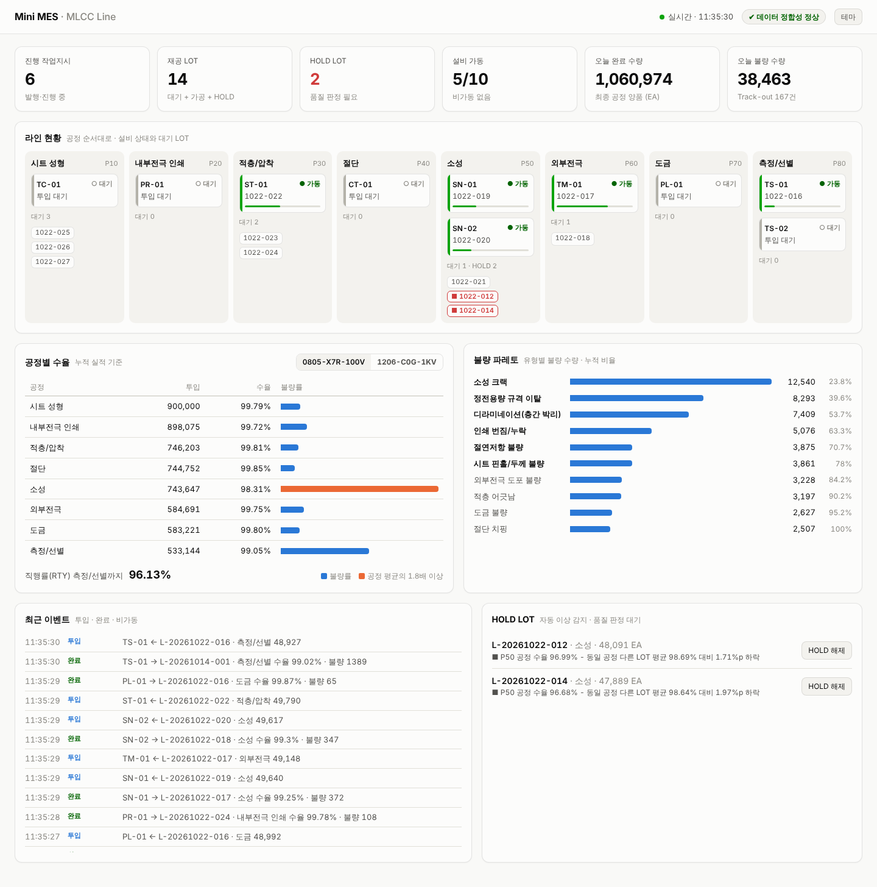
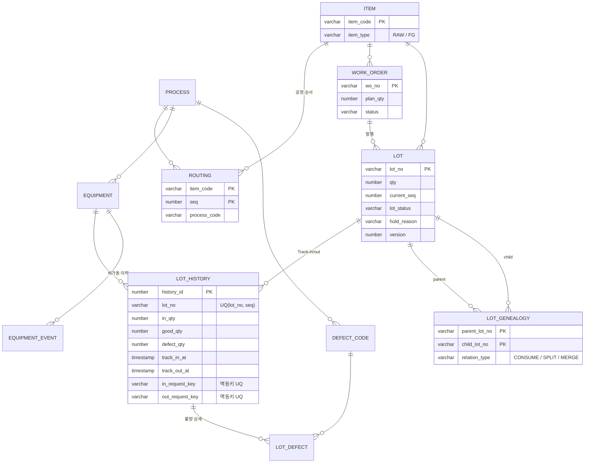

# Mini MES — MLCC Line

MLCC(적층세라믹콘덴서) 생산 라인을 가정한 소규모 MES입니다.
작업지시 → LOT 발행 → 공정 Track-in/out → 불량 등록 → 자동 HOLD → 추적 조회까지,
MES의 핵심 데이터 흐름을 Oracle 위에서 직접 설계하고, 설비 10대 시뮬레이터로 부하를 걸어 검증했습니다.

> 데이터 모델과 처리 규칙을 정의하고, AI 코딩 도구(Claude)를 활용해 API·시뮬레이터·대시보드를 구현했습니다.
> 커밋 메시지의 `Co-Authored-By` 표기는 이를 나타냅니다.



| 구성 | 기술 | 위치 |
|---|---|---|
| DB | Oracle 21c XE, 테이블 11개, 조회 쿼리 9개 | `db/` |
| API | Java 17, Spring Boot 3.3, JdbcClient (SQL 직접 작성) | `api/` |
| 설비 시뮬레이터 | Python (표준 라이브러리만) | `scripts/equipment_simulator.py` |
| 대시보드 | HTML/JS (빌드 없음, API 서버가 함께 제공) | `api/src/main/resources/static/` |

## 빠른 실행

1. SQL Developer에서 `db/01_schema.sql` → `db/02_seed.sql` 실행 (F5)
2. `api/src/main/resources/application.yml` 에서 DB 접속 정보 수정
3. IntelliJ에서 `api/pom.xml` 을 열고 `MiniMesApplication` 실행
4. 브라우저에서 `http://localhost:8080` → 대시보드
5. `python scripts/equipment_simulator.py` → 설비 10대가 움직이며 대시보드가 실시간으로 바뀜

## DB 스크립트

| 파일 | 내용 |
|---|---|
| `db/01_schema.sql` | 테이블 11개, 제약조건, 인덱스 (재실행 가능) |
| `db/02_seed.sql` | 샘플 데이터: 품목 6, 공정 8, 설비 10, 작업지시 3, LOT 11, 공정 이력 24 |
| `db/03_queries.sql` | 핵심 조회 쿼리 9개 (수율, 추적, 파레토, 이상 감지, 가동률, WIP, 정합성) |

## 공정 흐름

시트 성형(P10) → 내부전극 인쇄(P20) → 적층/압착(P30) → 절단(P40) → 소성(P50) → 외부전극(P60) → 도금(P70) → 측정/선별(P80)

수량은 모든 공정을 칩 환산 수량(EA)으로 단순화했습니다.

## ERD



## 샘플 시나리오 (2026-10-12 ~ 10-20)

| LOT | 상황 | 확인할 쿼리 |
|---|---|---|
| L-20261012-001 | 8개 공정 정상 완료 (최종 수율 96.8%) | Q1 수율 |
| L-20261012-002 | 도금 후 측정 설비 2대로 나누기 위해 **분할** → 002A 완료, 002B 측정 중 | Q2 역추적, Q4 이력 |
| L-20261014-001 | 소성로 SN-01에서 **크랙 불량 급증**(수율 96.0%, 다른 LOT 99.1%) → HOLD, 직후 설비 고장 기록 | Q6 이상 감지, Q7 가동률 |
| R-NI-2610-01 | Ni 페이스트 원자재 LOT. 공급사 품질 이슈 통보 가정 | Q3 정방향 추적 |

## 설계 결정 (면접에서 설명할 포인트)

- **라우팅을 별도 테이블로 분리**: 공정 순서를 코드가 아닌 기준정보로 관리. 품목이 늘어도 프로그램 수정 없이 라우팅만 등록.
- **`LOT_HISTORY`의 `UNIQUE(lot_no, seq)`**: 한 LOT이 같은 공정을 두 번 Track-in 하는 것을 DB 레벨에서 차단. (재작업은 현재 범위 밖)
- **`CHECK (good_qty + defect_qty = in_qty)`**: Track-out 시 수량이 맞지 않으면 저장 자체가 실패. 애플리케이션 버그가 있어도 잘못된 실적이 남지 않음.
- **`in_request_key` / `out_request_key` 멱등키**: 설비나 단말이 네트워크 문제로 같은 실적을 재전송해도 UNIQUE 제약으로 한 번만 반영. QR 주문 시스템에서 쓴 방식을 실적 수집에 적용.
- **`LOT_GENEALOGY` 하나로 투입·분할·병합 관리**: 관계 유형만 다르고 구조는 같으므로 한 테이블에 두고, Oracle `CONNECT BY`로 정/역방향 추적.
- **`LOT.version`**: 두 단말이 같은 LOT을 동시에 수정할 때 덮어쓰기를 감지하기 위한 버전 번호. 행 잠금과 함께 이중 안전장치로 사용.
- **인덱스는 조회 패턴 기준**: 역방향 추적용 `child_lot_no`, 설비별 실적 조회용 `(equipment_code, track_in_at)`, 파레토용 `defect_code`.
- **정합성 점검 쿼리(Q9)**: 불량 합계, 공정 간 수량 흐름, LOT 수량, 분할 수량, 설비 시간 중복을 검사. 결과 0건이 정상.

## API (2단계)

Spring Boot 3.3 + JdbcClient + Oracle. JPA 대신 SQL을 직접 작성해 잠금 범위와 실행 쿼리를 드러냈습니다.

### 실행

1. `db/01_schema.sql` → `db/02_seed.sql` 실행 (스키마가 바뀌었으면 다시 실행)
2. `api/src/main/resources/application.yml` 에서 DB 접속 정보 수정 (`url`, `username`, `password`)
3. IntelliJ에서 `api/pom.xml` 을 프로젝트로 열고 `MiniMesApplication` 실행
4. `python scripts/demo_scenario.py` 로 시나리오 테스트, 또는 `api/api.http` 로 요청 하나씩 실행

### 엔드포인트

| Method | URL | 설명 |
|---|---|---|
| POST | `/api/work-orders` | 작업지시 생성 + LOT 자동 발행 |
| GET | `/api/work-orders` | 작업지시 목록 (LOT 수, 완료 수량) |
| POST | `/api/lots/{lotNo}/track-in` | 공정 투입 |
| POST | `/api/lots/{lotNo}/track-out` | 공정 완료 (양품/불량 등록, 자동 HOLD 판정) |
| POST | `/api/lots/{lotNo}/release-hold` | HOLD 해제 |
| GET | `/api/lots/{lotNo}` | LOT 상세 + 분할 이전 이력 포함 전체 공정 이력 |
| GET | `/api/lots/{lotNo}/trace?direction=backward\|forward` | LOT 추적 |
| GET | `/api/wip` | 재공 현황 |
| GET | `/api/reports/process-yield` | 공정별 수율·직행률 |
| GET | `/api/equipment` | 설비 목록 (현재 LOT, 비가동 사유, 오늘 양품) |
| POST | `/api/equipment/{code}/status` | 설비 상태 변경 IDLE / DOWN(고장) / PM(보전), 멱등 처리 |
| GET | `/api/reports/summary` | 대시보드 KPI |
| GET | `/api/reports/defect-pareto` | 불량 파레토 |
| GET | `/api/reports/recent-activity` | 최근 투입·완료·비가동 이벤트 |
| GET | `/api/reports/integrity` | 데이터 정합성 점검 (빈 배열이면 정상) |

### Track-in/out 처리 순서 (한 트랜잭션)

1. **LOT 행 잠금** `SELECT ... FOR UPDATE WAIT 5` — 같은 LOT 요청을 한 줄로 세움. 5초 안에 못 잡으면 409 `LOCK_TIMEOUT`
2. **멱등키 확인** — 잠금 *이후에* 확인해야 동시에 들어온 재전송도 정확히 걸러짐
3. **업무 규칙 검증** — LOT 상태, 라우팅 다음 공정, 설비-공정 일치, 설비 IDLE 여부, 양품+불량=투입, 불량 코드-공정 일치
4. **설비 행 잠금** — 항상 LOT → 설비 순서로 잠가 데드락 방지
5. **갱신** — 이력, 불량 상세, LOT(version 조건부 UPDATE), 설비 상태, 작업지시 상태
6. **자동 HOLD** — Track-out 수율이 같은 공정의 *다른 LOT* 누적 수율보다 1%p 이상 낮으면 HOLD (기준은 `mes.hold.yield-drop-threshold`)

### 오류 코드

| HTTP | code | 상황 |
|---|---|---|
| 404 | `LOT_NOT_FOUND`, `EQUIPMENT_NOT_FOUND` | 대상 없음 |
| 409 | `INVALID_LOT_STATUS` | WAIT 아닌 LOT 투입, RUN 아닌 LOT 완료, HOLD LOT 투입 |
| 409 | `EQUIPMENT_PROCESS_MISMATCH` | 다음 공정과 다른 공정의 설비 |
| 409 | `EQUIPMENT_NOT_AVAILABLE` | 설비가 RUN/DOWN/PM |
| 409 | `EQUIPMENT_BUSY` | 가공 중인 설비를 DOWN/PM 처리 |
| 409 | `ROUTING_END` | 모든 공정 완료 |
| 409 | `REQUEST_KEY_CONFLICT` | 멱등키가 다른 LOT에 이미 사용됨 |
| 409 | `LOCK_TIMEOUT`, `CONCURRENT_UPDATE` | 동시 요청 충돌 |
| 400 | `QTY_MISMATCH` | 양품 + 불량 ≠ 투입 |
| 400 | `DEFECT_CODE_NOT_FOUND`, `DEFECT_CODE_PROCESS_MISMATCH` | 불량 코드 오류 |

### 시나리오 테스트 (`scripts/demo_scenario.py`)

작업지시 생성, 8개 공정 정상 흐름, 멱등 재전송, 규칙 위반 차단 4종, 자동 HOLD와 해제,
그리고 **같은 LOT에 동시 요청 10건을 보내 정확히 1건만 반영되는지**까지 자동으로 확인합니다.

## 설비 시뮬레이터 (3단계)

`scripts/equipment_simulator.py` — 설비 10대가 각각 스레드로 동작하며 현장처럼 실적을 보냅니다.

| 재현하는 상황 | MES가 해야 하는 일 |
|---|---|
| 같은 공정 설비 2대(소성로, 측정기)가 같은 대기 LOT을 동시에 잡으려 함 | 한 대만 성공, 나머지는 `INVALID_LOT_STATUS` |
| 서버는 처리했는데 응답만 유실 → 같은 요청키로 재전송 (기본 10%) | `replayed: true` 로 같은 결과 반환, 수량 이중 반영 없음 |
| 가공 후 일정 확률로 설비 고장(DOWN) → 몇 초 뒤 복구 | 비가동 이력 기록, 고장 중 투입 차단 |
| 소성로 SN-01의 불량률이 시간이 갈수록 상승 (히터 열화 가정) | 자동 HOLD → HOLD 연속 2회면 설비 보전(PM) |
| 품질 담당자가 HOLD LOT을 일정 시간 뒤 해제 | HOLD → WAIT, 다음 공정 진행 |
| 착수 대기 LOT이 부족하면 작업지시 발행 | LOT 자동 발행 |

종료 시 실적 통계와 `/api/reports/integrity` 정합성 점검 결과를 출력합니다.

```
python scripts/equipment_simulator.py --duration 300 --loss 0.1 --drift SN-01
```

## 대시보드 (4단계)

`http://localhost:8080` — 2초마다 갱신.

- **KPI**: 진행 작업지시, 재공 LOT, HOLD LOT, 설비 가동, 오늘 완료·불량 수량
- **라인 현황**: 공정 순서대로 설비 상태(가동/대기/고장/보전), 가공 중 LOT과 진행률, 공정별 대기·HOLD LOT
- **공정별 수율**: 품목 선택, 공정별 불량률 막대(평균보다 높은 공정 강조), 직행률(RTY)
- **불량 파레토**, **최근 이벤트**, **HOLD LOT 목록과 해제 버튼**
- **데이터 정합성 배지**: 10초마다 점검 API를 호출해 이상 여부 표시
- 라이트/다크 모드, 모바일 화면 지원

## 개발 중 발견하고 고친 문제

- **설비 복구 요청의 멱등 처리 누락**: 시뮬레이터로 응답 유실을 재현하자, 고장 → 복구(IDLE) 요청을 재전송했을 때
  `replayed: false` 가 돌아오는 것을 발견. 비가동 *시작* 요청키만 저장하고 *종료* 요청키는 저장하지 않았던 것이 원인.
  `equipment_event.end_request_key` 를 추가해 해결.
- **Oracle 21c 호환**: SQL 문장 뒤 같은 줄 주석이 최신 Oracle(23ai)에서 `ORA-03405` 를 내는 문제,
  `EXISTS` 를 비교식에 쓰는 23ai 전용 문법을 21c에서도 동작하는 `CASE` / `COUNT` 로 변경.

## 검증 결과

개인 PC(Windows, Oracle Database **21c Express Edition**)에서 처음부터 설치해 직접 실행한 결과 (2026-10-23).

| 항목 | 결과 |
|---|---|
| `demo_scenario.py` 시나리오 테스트 | **PASS 21 / FAIL 0** |
| 동시 Track-in 10건 (같은 LOT) | 1건 성공, 9건 `INVALID_LOT_STATUS` |
| 같은 멱등키 동시 재전송 10건 | 실제 처리 1건, 재전송 응답 9건, 수량 이중 차감 없음 |
| 설비 시뮬레이터 5분 | Track-in/out **808 / 809건**, 완료 LOT 98개 (5,027,703 EA) |
| 응답 유실 후 재전송 | **163건 전부** 이중 처리 없이 복구 |
| 자동 HOLD / 해제 | 8 / 9건 (샘플 데이터의 HOLD 1건 포함), 연속 HOLD로 인한 설비 점검 4회 |
| 설비 고장 | 20회, 고장 중 투입 0건 |
| 실적 처리 오류 (Track-in / Track-out) | 0 / 0건 |
| 데이터 정합성 점검 (`/api/reports/integrity`) | **이상 0건** |

대시보드 다크 모드: [docs/dashboard-dark.png](docs/dashboard-dark.png)

## 로드맵

- [x] 1단계: ERD, DDL, 샘플 데이터, 핵심 조회 쿼리
- [x] 2단계: Spring Boot API — 작업지시, Track-in/out, 라우팅 검증, 멱등 처리, 행 잠금, 자동 HOLD
- [x] 3단계: Python 설비 시뮬레이터 — 동시 경쟁, 응답 유실 재전송, 고장, 공정 이상
- [x] 4단계: 실시간 대시보드
- [ ] 다음: 재작업(Rework) 라우팅, 작업자 권한, 설비 PLC 프로토콜(OPC UA) 연동
